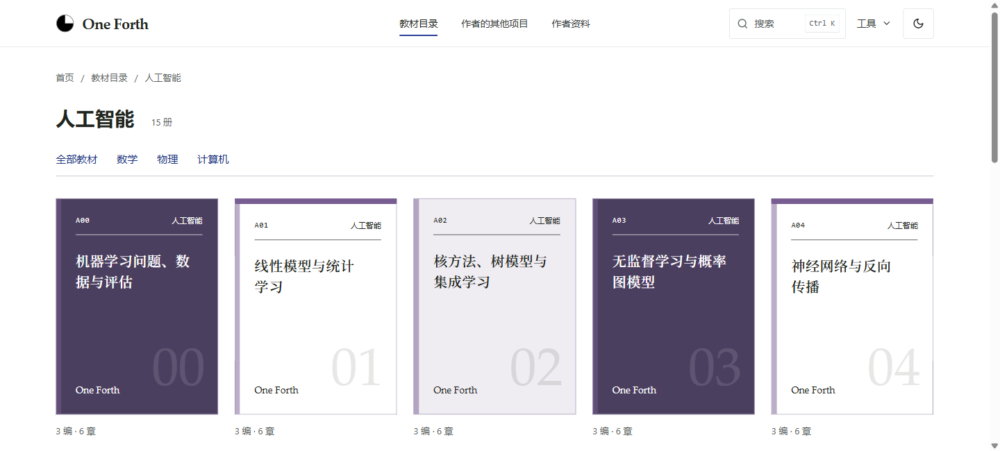
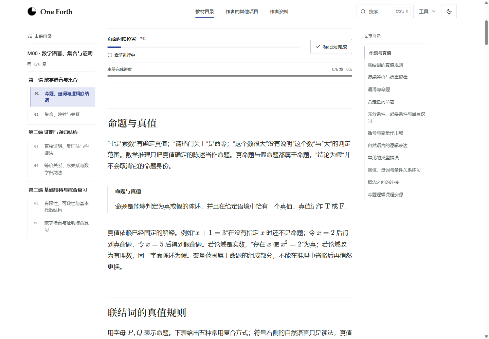
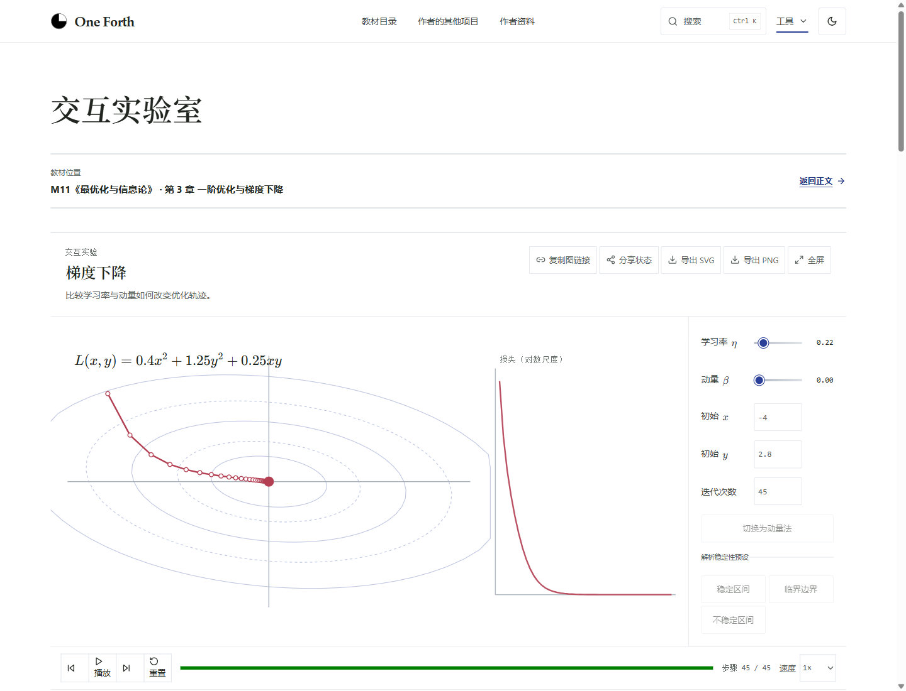

# One Forth

**把公式读懂，把推导走通，把参数调起来。**

One Forth 是一套中文在线教材，连接数学、物理、计算机与人工智能。你可以沿着章节系统学习，也可以从一个概念、一条公式或一个实验开始。

**[开始阅读 →](https://one-forth.com/zh-CN)** · **[国内入口 →](https://cn.one-forth.com/zh-CN)** · [试试交互实验](https://one-forth.com/zh-CN/playground) · [参与完善](CONTRIBUTING.md)

_Interactive textbooks for mathematics, physics, computer science and artificial intelligence._

[](https://one-forth.com/zh-CN)

## 从问题走到理解

学习梯度下降时，可以先读梯度与迭代公式，再调整学习率和动量，观察优化轨迹与损失曲线如何变化。学习线性映射时，可以把矩阵运算与平面中的几何变化放在一起看。

我们希望把这些环节放进同一条学习路径：

**直觉与问题 → 定义与条件 → 推导与证明 → 例题 → 交互实验 → 练习与延伸阅读。**

你可以在站内：

- **顺着教材读**：按册、章、节浏览，结合例题和练习逐步推进。
- **动手验证直觉**：调整实验参数，对照图形、公式与数值变化。
- **找到知识之间的联系**：使用知识图谱和学习路径梳理先修关系。
- **随时查阅**：用中文、英文、符号或 LaTeX 搜索章节、概念、公式和资源。

演示帮助理解现象，定义、条件和证明给出结论的适用范围。教材仍在持续修订，欢迎指出具体错误和遗漏。

## 选择你的起点

| 领域                                                                  | 可以从这里开始                   | 继续探索                                     |
| --------------------------------------------------------------------- | -------------------------------- | -------------------------------------------- |
| [数学](https://one-forth.com/zh-CN/books/mathematics)                 | 数学语言、集合与证明；代数与函数 | 微积分、线性代数、概率统计、数值方法与最优化 |
| [物理](https://one-forth.com/zh-CN/books/physics)                     | 测量、单位与力学                 | 电磁学、振动与波、热学、量子力学与相对论     |
| [计算机](https://one-forth.com/zh-CN/books/computer-science)          | 编程基础与计算思维               | 算法、计算机组成、操作系统、网络与数据库     |
| [人工智能](https://one-forth.com/zh-CN/books/artificial-intelligence) | 线性模型与机器学习基础           | 神经网络、生成模型、检索增强与智能体         |

不确定从哪开始，可以先读 [命题、量词与逻辑联结词](https://one-forth.com/zh-CN/books/mathematics/mathematical-language-sets-proofs/logic-propositions)，或打开 [学习路径](https://one-forth.com/zh-CN/paths) 选择一个主题。

<details>
<summary>看看教材目录与正文</summary>

**教材目录**：按主题组织章节，标明学习起点。

[](https://one-forth.com/zh-CN/books/artificial-intelligence)

**正文阅读**：定义、推导、例题、练习与参考资料放在相应章节。

[](https://one-forth.com/zh-CN/books/mathematics/mathematical-language-sets-proofs/logic-propositions)

</details>

## 让参数和公式一起变化

在 [交互实验室](https://one-forth.com/zh-CN/playground) 中，可以观察线性变换、梯度下降、神经网络决策边界、注意力权重与波动等主题。

以梯度下降为例：改变学习率，观察轨迹收敛或发散；加入动量，再对比每一步的位置和损失。实验提供播放、步进、重置、状态分享和图形导出等控件，具体能力以各实验界面为准。

[](https://one-forth.com/zh-CN/playground)

**[打开实验室 →](https://one-forth.com/zh-CN/playground)**

## 阅读与查阅工具

| 入口                                                                                                                                               | 用途                               |
| -------------------------------------------------------------------------------------------------------------------------------------------------- | ---------------------------------- |
| [全站搜索](https://one-forth.com/zh-CN/search)                                                                                                     | 查找章节、概念、公式、实验和资料   |
| [知识图谱](https://one-forth.com/zh-CN/graph)                                                                                                      | 查看概念间的先修、推导与其他关系   |
| [学习路径](https://one-forth.com/zh-CN/paths)                                                                                                      | 沿主题组织阅读与自测               |
| [术语表](https://one-forth.com/zh-CN/glossary) · [符号表](https://one-forth.com/zh-CN/symbols) · [公式索引](https://one-forth.com/zh-CN/equations) | 在阅读时快速回查                   |
| [课程与参考资料](https://one-forth.com/zh-CN/resources)                                                                                            | 继续阅读教材、课程、论文与官方文档 |

网站支持手机和桌面阅读、深浅主题及键盘操作。主题偏好、阅读进度和最近搜索保存在浏览器本地。

## 本地运行

仅阅读教材，直接访问 [网站](https://one-forth.com/zh-CN) 即可。希望修改内容或研究实现，可以运行完整项目。

环境：**Node.js 24**、**pnpm 11**。仓库通过 `packageManager` 声明 pnpm 版本，并提供锁文件。

```bash
git clone https://github.com/CSZSmaf/one-forth.git
cd one-forth
pnpm install --frozen-lockfile
pnpm dev
```

打开 `http://localhost:3000/zh-CN`。本地阅读、实验和构建不需要 API key、数据库或托管账户。

```bash
pnpm build                         # 生产构建
pnpm test                          # 单元、组件与脚本测试
pnpm validate:content              # 内容与引用结构校验
pnpm check:links                   # 内容链接与资源标识校验
```

更多检查见 [测试说明](docs/testing.md)，运行时与托管方式见 [构建说明](docs/deployment.md)。

## 项目结构

项目使用 TypeScript、React、Vinext/Vite、MDX 与 KaTeX，通过 pnpm workspace 和 Turborepo 管理。数学模型、教材数据与界面分别维护。

```text
apps/web/                    页面、组件、阅读工具与实验展示
apps/edge-proxy/             可选的固定源站代理
content/                     教材原文与可审阅内容数据
packages/config/             站点、语言与界面文案
packages/content/            内容 Schema、仓库与编译数据
packages/search/             本地搜索
packages/knowledge-graph/    知识关系与图布局
packages/visualization/      实验注册、控件与渲染适配
packages/math-core/          纯数学模型
packages/numerical/          数值方法
packages/physics/            物理模型
packages/simulation-runtime/ 仿真运行时
packages/ui/                 通用展示与语义组件
scripts/                     生成、迁移与校验工具
```

详细边界见 [架构说明](docs/architecture.md)。网站继续由现有托管服务提供；此仓库用于开放源码、教材与协作。

## 一起把教材写得更好

你可以帮助我们纠正公式与推导、补充例题与练习、核对引用，或改善实验、搜索、移动端与无障碍体验。

- 发现问题：[提交 Issue](https://github.com/CSZSmaf/one-forth/issues)。附上页面链接、具体位置和依据即可。
- 准备修改：[阅读贡献指南](CONTRIBUTING.md)，从一个明确的小问题开始。
- 觉得有用：欢迎分享具体章节，或 Star 仓库，方便以后找到项目。

## 许可与引用

**程序代码：[MIT](LICENSE)。原创教材：[CC BY-SA 4.0](CONTENT-LICENSE.md)。**

转载论文图、字体、图标和第三方依赖保留各自许可，详见 [第三方资源说明](THIRD_PARTY_NOTICES.md)。引用教材时，请注明 One Forth、原章节链接与许可；修改后请说明改动。

**[从一章教材开始 →](https://one-forth.com/zh-CN)**
