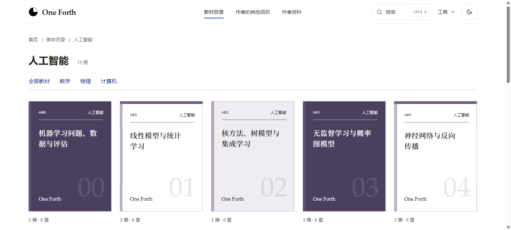
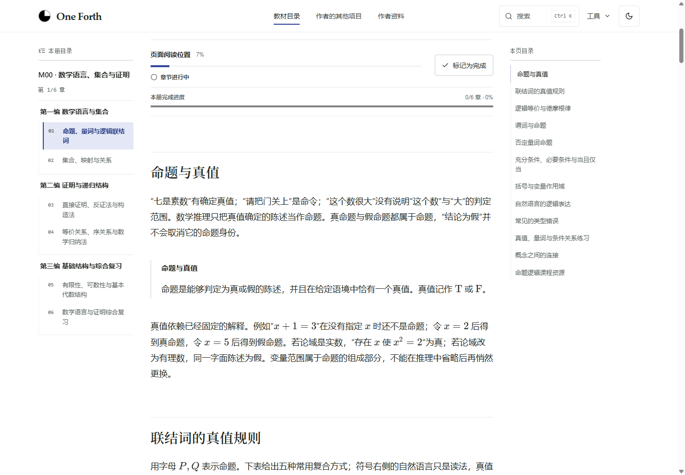
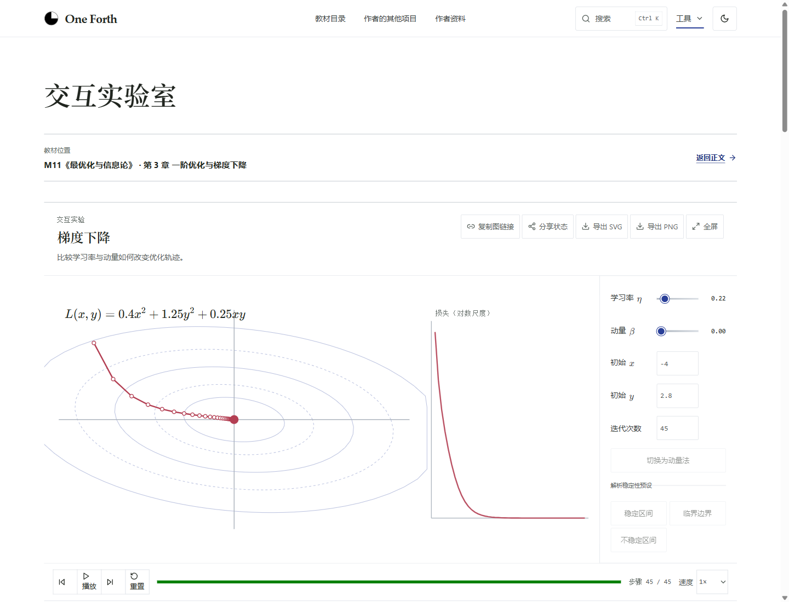

# One Forth

数学、物理、计算机与人工智能教材，附例题、练习和交互实验。

**[进入网站](https://one-forth.com/zh-CN)** · [国内入口](https://cn.one-forth.com/zh-CN)

- [数学](https://one-forth.com/zh-CN/books/mathematics)
- [物理](https://one-forth.com/zh-CN/books/physics)
- [计算机](https://one-forth.com/zh-CN/books/computer-science)
- [人工智能](https://one-forth.com/zh-CN/books/artificial-intelligence)

[交互实验](https://one-forth.com/zh-CN/playground) · [课程与参考资料](https://one-forth.com/zh-CN/resources)

## 首页

## 教材目录

## 正文阅读

## 交互实验

